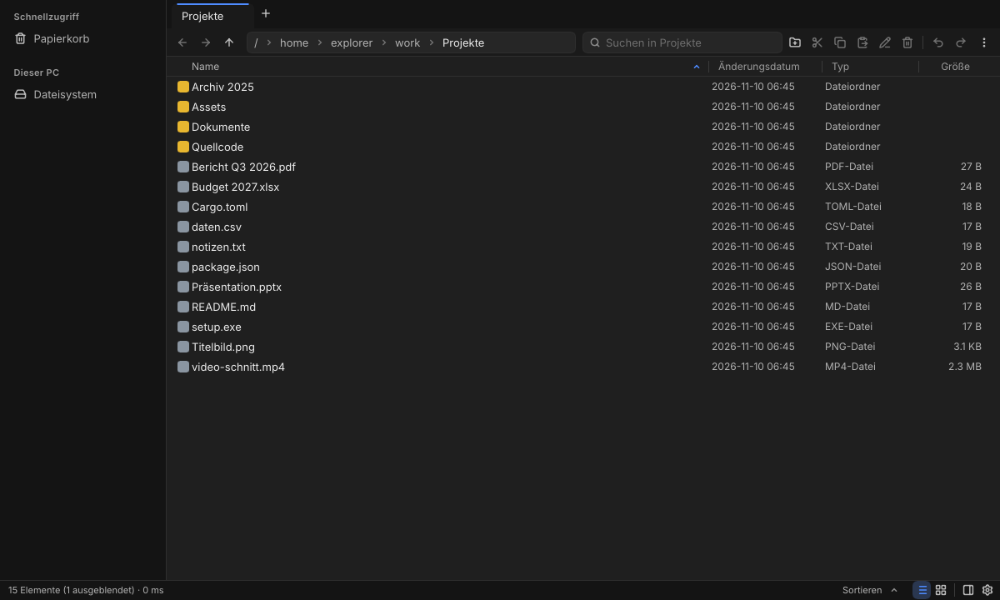
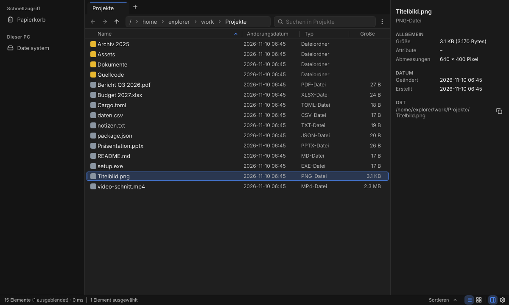
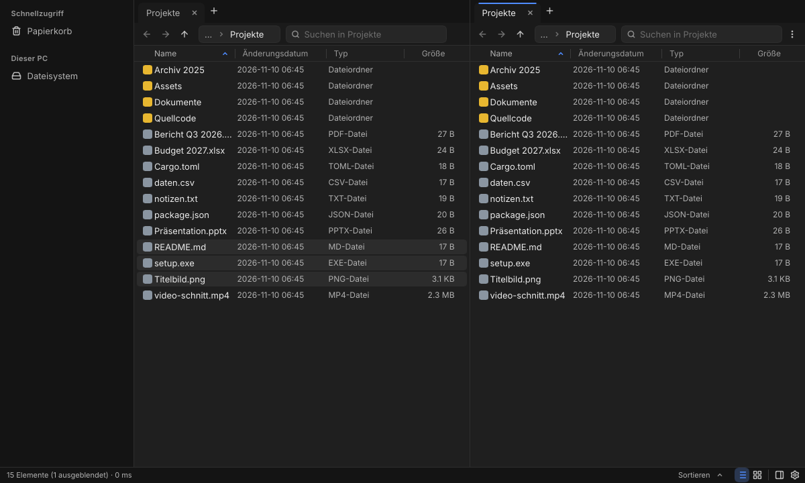
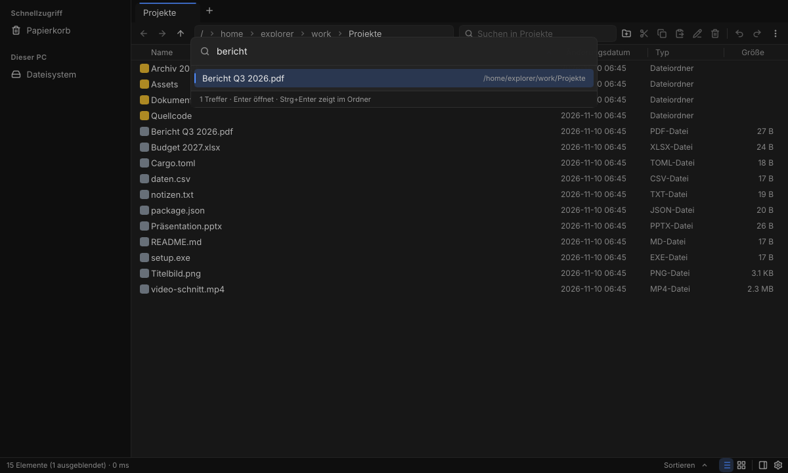

# Explorer 2.0

A fast, modern, robust replacement for Windows Explorer on Windows 10/11 x64, written in Rust with [Slint](https://slint.dev). Its direction is [File Pilot](https://filepilot.tech): tabs, split view, an Inspector, a command palette, keyboard-first use, plus an instant search in the style of voidtools Everything.



> The user interface is currently **German** (localisation is planned, see `docs/TODO.md`). The screenshots come from the Linux UI gallery (`scripts/gallery.sh`), so the font differs from Windows' Segoe UI.

## Features

- **Fast with huge folders**: the UI thread never does I/O. A folder with 100,000 files shows its first rows in about 1 ms and is fully loaded in about 150 ms (Windows CI). A normal start takes about 55 ms.
- **Tabs and two views**: tabs per pane, split view (`Ctrl+\`), history per tab, and the session is restored on the next start.
- **File operations you can trust**: copy, move, delete and rename run in the background with progress, pause and cancel. Copies go through a temp file plus rename, and a source is only deleted after a complete, flushed copy. “Replace” sends the old file to the Recycle Bin. Undo/redo (`Ctrl+Z`/`Ctrl+Y`) covers all of it.
- **Explorer compatible**: real shell icons and thumbnails, the clipboard works both ways with Windows Explorer, OLE drag & drop to and from other apps, Properties dialogs, Recycle Bin, This PC, network shares, libraries, `shell:` and `%VAR%` paths in the address bar, and Explorer's folder options.
- **Instant search without admin rights**: a name index per drive that is saved to disk and kept current live. Queries over 1 million entries take under 10 ms. You can search from the current folder (`Ctrl+F`) or across all drives (`Ctrl+Shift+F`). The query language is an Everything subset: `ext:pdf`, `size:>100mb`, `dm:thisweek`, `path:`, `regex:`, `|`, `!`, `"…"`.
- **Inspector** (`Alt+P`): preview, size, dates, attributes, image dimensions, folder sizes counted in the background.
- **Command palette** (`Ctrl+Shift+P`): every command with its shortcut and fuzzy search. Typing `>` jumps to places.
- **Colour schemes**: Like Windows (follows the system live), Light or Dark. Dark is the default. The Windows accent colour can be used, and every colour is contrast-tested (WCAG).
- **Windows integration, opt-in and reversible**: open folders in Explorer 2.0 by double-click or via “Open folder”, an “Open in Explorer 2.0” entry in the context menu, and Win+E. Each can be switched on or off on its own.
- **Robust**: single instance (a second start opens a tab in the running window), crash reports, and a start guard that falls back to a safe start after two failed starts.

| Inspector | Two views |
|---|---|
|  |  |
| **Quick search across all drives** | **Light theme, tile view** |
|  |  |

## Download and installation

Get the latest version from **[Releases](https://github.com/TeslaV0D/explorer-2.0/releases/latest)**:

- **Setup**: download `Explorer2-Setup-<version>-x64.exe` and double-click it. It installs per user, without administrator rights, to `%LOCALAPPDATA%\Programs\Explorer2`. You get a Start menu entry and an entry under “Settings → Apps”. Running a newer setup over an existing installation updates it, even while Explorer 2.0 is open.
- **Portable**: unpack `Explorer2-<version>-x64-portable.zip` and start `explorer2.exe`. You can still install it later from the app (Einstellungen → Installation).
- **Checksums**: `SHA256SUMS.txt`, check them with `Get-FileHash`.

The files are not signed yet, so Windows may show “Windows protected your PC”. Click **More info → Run anyway**.

Uninstall via “Settings → Apps → Explorer 2.0 → Uninstall”. This resets all Windows integrations and removes the program. Your settings in `%APPDATA%\Explorer2` are kept.

## Emergency exit: one-button reset

Every Windows integration is **off** after installation, and each one can be undone completely. Before any change, the original state is written to a journal (atomic, with a mirror copy and a checksum). A reset then restores exactly that state, and values that other software has changed in the meantime are left alone. If the journal is missing or broken, a sweep of the known locations still cleans up.

There are three ways to reset:

1. In the app: Einstellungen → Windows-Integration → “Alle Windows-Integrationen zurücksetzen”.
2. From the Start menu: “Explorer 2.0 – Windows-Standard wiederherstellen”.
3. If the app does not start at all (this also works in Safe Mode), use the console tool:

```bash
explorer2-recover.exe --status
```

```bash
explorer2-recover.exe --yes
```

CI checks this on every run: registry snapshot → all integrations on → reset → the snapshot must be identical. It runs from the journal, from a half-destroyed journal and without any journal.

## Keyboard shortcuts (selection)

| Keys | Action |
|---|---|
| `Ctrl+T` / `Ctrl+W` / `Ctrl+Tab` | New tab / close tab / next tab |
| `Ctrl+\` / `F6` | Two views on/off / switch view |
| `Alt+←` / `Alt+→` / `Alt+↑` | Back / forward / up |
| `Ctrl+L` | Edit the path |
| `Ctrl+F` / `Ctrl+Shift+F` | Search in this folder / quick search across all drives |
| `Ctrl+Shift+P` | Command palette |
| `Alt+P` | Inspector |
| `F2` / `Ctrl+Shift+N` | Rename / new folder |
| `Del` / `Shift+Del` | Recycle Bin / delete permanently |
| `Ctrl+Z` / `Ctrl+Y` | Undo / redo |
| `Ctrl+Shift+1/2/3/6` | Extra large / large / medium icons / details |

## Building from source

Requires Rust stable (≥ 1.88). The target platform is Windows x64. The core crates and the UI also build and run on Linux, which is used for development and tests.

```bash
cargo build --release -p explorer2
```

```bash
cargo build --release -p explorer-integrate --bins
```

The second command builds the recovery tool `explorer2-recover`. On Linux, Slint needs the usual X11/Wayland development libraries. For headless tests you also need `xvfb`, `xdotool` and `imagemagick`.

Check locally before pushing:

```bash
cargo fmt --all -- --check && cargo clippy --workspace --all-targets -- -D warnings && cargo test --workspace
```

## Tests and CI

GitHub Actions (`.github/workflows/ci.yml`) runs on Windows and Linux:

- `fmt`, `clippy -D warnings` and all unit and integration tests, including random-data tests for every parser.
- Performance gates: a 100k folder, the search index over 1 M entries, cold-start budget < 300 ms, exe size < 20 MB.
- Linux E2E under Xvfb (`scripts/e2e.sh`, about 270 checks; tests click controls by name through a UI dump).
- Windows E2E with real keyboard and mouse input (`scripts/e2e-windows.ps1`), plus tests for the installer, crash handling, single instance, endurance runs and the R-001 snapshot.
- Screenshot galleries of all main screens as artifacts.

To run the Linux E2E locally:

```bash
xvfb-run -a -s "-screen 0 1280x800x24" scripts/e2e.sh $PWD/target/release/explorer2 /tmp/e2e
```

**Releases**: raise the version in `Cargo.toml` and push it. `.github/workflows/release.yml` sees a version without a release, builds and tests the setup, creates the tag `v<version>` and publishes the release.

## Project structure

| Crate | Content |
|---|---|
| `crates/app` (`explorer2`) | Slint UI (`ui/*.slint`), window controller, file operation UI, search UI, installer, crash handling |
| `crates/core` | Platform-neutral model: sorting, selection, settings, commands, colour schemes, query helpers |
| `crates/fs` | Directory enumeration (`FindFirstFileExW` on Windows), loader, watcher, places, network shares |
| `crates/ops` | Job engine for copy/move/delete, undo, clipboard |
| `crates/shell` | Windows shell: icons, thumbnails, type names, context menu, libraries, theme |
| `crates/index` | Name index and query language of the search |
| `crates/search` | Index service: build, persistence, reconciliation, live updates |
| `crates/integrate` | Windows integrations with journal and reset (R-001), installer, `explorer2-recover` |
| `crates/gpu` | OpenGL probe that picks the renderer (GPU or software) |
| `crates/setup` | Single-file setup `Explorer2-Setup` |

Documentation lives in `docs/`: `PROJECT.md` (vision), `PLAN-*.md` (plans), `WINDOWS-INTEGRATION.md`, `STATUS.md` (current state), `TODO.md`, and `FIELD-TEST-*.md` (checklists for testing on real Windows). Third-party licenses are listed in `THIRD-PARTY.md`.

## License

[MIT](LICENSE). The UI icons come from [Lucide](https://lucide.dev) (ISC/MIT), see `THIRD-PARTY.md`.
